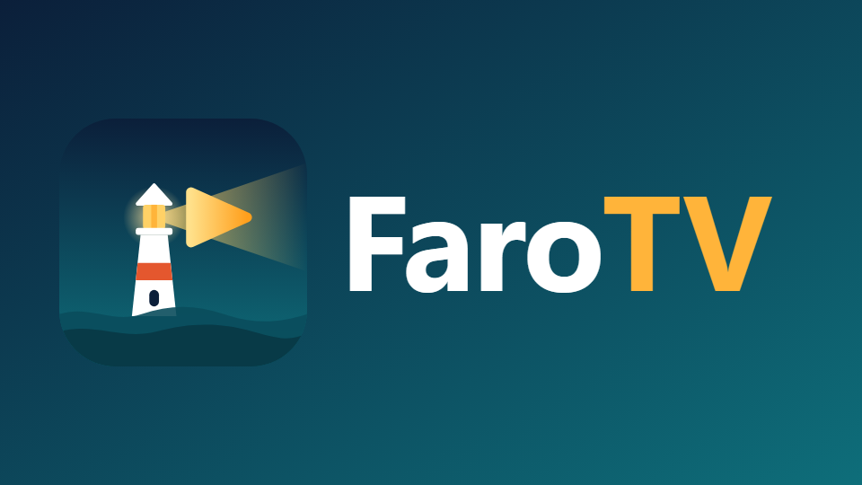

<p align="center">
  
</p>

# FaroTV Patches

Parches no oficiales para **YouTube en Android TV** (`com.google.android.youtube.tv`), compatibles con
[Morphe](https://morphe.software). *Unofficial patches for YouTube on Android TV, compatible with Morphe.*

FaroTV no es un producto de Google, YouTube ni del proyecto Morphe.

## ✨ Qué hace

- **MicroG-RE**: la app funciona sin Google Play Services y se instala junto al YouTube original (otro nombre de
  paquete). Inicio de sesión con código de activación (yt.be/activate).
- **Sección FaroTV dentro de los Ajustes de YouTube**, con interruptores:
  - Bloquear anuncios (de video y los videos "Patrocinado" de Inicio).
  - Ocultar Shorts.
  - Ocultar las pestañas temáticas (Videojuegos, Noticias, Deportes…).
  - Personalizar el reproductor: ocultar los botones Canal, Descripción, Suscribirse, Me gusta / No me gusta,
    Comentarios, Preguntar (IA), Guardar, Súper gracias, Denunciar y Estadísticas, y la fila de videos relacionados.
  - Las opciones que necesitan reiniciar muestran el diálogo propio de YouTube con el botón **Reiniciar**.
- **Marca FaroTV**: nombre, icono, banner de Android TV y logo dentro de la app (se puede cambiar el nombre).
- **Spoof device** (desactivado por defecto): hace pasar el TV por un Chromecast, para televisores que YouTube
  marca como "no compatibles".

## 📦 Cómo usarlos

1. Instala [MicroG-RE](https://github.com/MorpheApp/MicroG-RE/releases) en el TV.
2. Añade este repositorio como fuente de parches en Morphe Manager:
   https://github.com/jair1c/farotv-patches

   <a href="https://morphe.software/add-source?github=jair1c/farotv-patches">
     
   </a>

3. Parchea tu propio APK de **YouTube for Android TV 7.32.300** (armeabi-v7a) e instálalo en el TV.

Este repositorio **no** distribuye el APK de YouTube, ni original ni parcheado.

## 🩹 Lista de parches

<!-- PATCHES_START EXPANDED -->

<!-- Do not modify this section by hand. The patch list is generated when release.yml creates a new release. -->

#### La lista aparecerá aquí cuando se publique la primera versión.

<!-- PATCHES_END -->

## 🛠️ Cómo funciona

YouTube para Android TV es una capa Android (Cobalt, basado en Chromium) que carga la web `youtube.com/tv`.
- Los parches de bytecode añaden MicroG-RE, mantienen activo el observador de navegación de Cobalt e inyectan los
  scripts de `extensions/extension/src/main/js/` en cada carga de página.
- Los scripts modifican las respuestas de InnerTube (`JSON.parse`) y registran los ajustes como ajustes propios de
  YouTube.
- "Spoof device" añade `libytvshim.so` (fuente en `native/ytvshim/`), que responde a las consultas de marca y modelo
  del motor nativo.

Más detalles en [docs/ANALISIS_YOUTUBE_TV.md](docs/ANALISIS_YOUTUBE_TV.md).

### Compilar

Requiere Java 21 y un token de GitHub con permiso `read:packages`:

```bash
GITHUB_ACTOR=<usuario> GITHUB_TOKEN=<token> ./gradlew buildAndroid
```

Resultado: `patches/build/libs/patches-<versión>.mpp`. Las versiones se publican solas con `release.yml` al subir
commits `feat:` / `fix:` a `dev` (prerelease) o `main` (estable).

## ⚖️ Licencia y créditos

GPLv3 (ver [LICENSE](LICENSE) y [NOTICE](NOTICE)).
- Partes de GmsCore support y Clone app vienen de [Morphe](https://github.com/MorpheApp/morphe-patches)
  y ReVanced.
- El sistema de scripts y ajustes se basa en [utv-runtime](https://github.com/DylanDuff/utv-runtime) (MIT, Dylan Duff).
- La inyección de JavaScript se basa en [ysamjo/morphe-patches](https://github.com/ysamjo/morphe-patches) (GPLv3).
